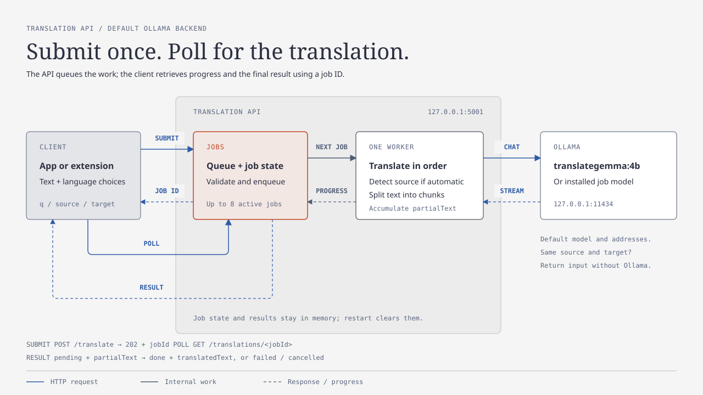

# Translation API

Local translation server with an HTTP API for applications and browser extensions.
The default setup runs on the same computer as your client and uses Ollama with
the `translategemma:4b` model.

## Before you start

Install and start [Ollama](https://ollama.com/download), then download the model:

```sh
ollama pull translategemma:4b
```

If Ollama is not running in the background, keep `ollama serve` running in a
separate terminal. By default, the API connects to Ollama at `http://127.0.0.1:11434`.
Startup checks that Ollama lists the configured model. See Ollama's installation documentation for operating-system
and GPU requirements.

## Linux: Debian, Ubuntu, Fedora and Arch

Install Python 3.11 or newer, Git and venv/pip support using the
[distribution commands](docs/deployment.md#linux-installation), then:

```sh
git clone https://github.com/tomasmark79/translation-api.git
cd translation-api
bash install-linux.sh
~/.local/bin/translation-api
```

Run the installer as your regular user, without `sudo`. It installs the API in
its own Python virtual environment. Ollama and the model are installed separately
as described above. Use `bash install-linux.sh --service` instead to enable
automatic startup in your user systemd session.

See [deployment options](docs/deployment.md#linux-installation) for
configuration, updates and uninstalling.

## NixOS, Linux with Nix, or macOS

Install [Nix](https://nixos.org/download/) and
[enable `nix-command` and `flakes`](docs/deployment.md#enable-nix-commands-and-flakes),
then run:

```sh
nix run 'git+https://github.com/tomasmark79/translation-api?ref=main'
```

The Nix package supports Linux, Intel macOS and Apple Silicon macOS.
Ollama and the model must be installed separately as described above.

## Windows

Install Python 3.11 or newer and Git. In PowerShell, clone the repository and
open its folder:

```powershell
git clone https://github.com/tomasmark79/translation-api.git
cd translation-api
```

Install the dependencies and start the server:

```powershell
py -m pip install -r requirements.txt
py server.py
```

Alternatively, keep dependencies in a project-local virtual environment:

```powershell
py -m venv .venv
.\.venv\Scripts\python.exe -m pip install -r requirements.txt
.\.venv\Scripts\python.exe server.py
```

Use the same Python executable to install dependencies and start the server.
The virtual-environment commands do not require activation.


## Connect your client

Keep the server terminal open while using your client. Set the client's
translation API address to `http://127.0.0.1:5001` if it is not already the
default. The API listens only on the local computer by default. Stop the server
with Ctrl+C.

Check availability from another terminal.

On Linux or macOS:

```sh
curl http://127.0.0.1:5001/health
```

On Windows:

```powershell
Invoke-RestMethod http://127.0.0.1:5001/health
```

The response should include `"status": "ready"`. This confirms that the API is
responding; it does not run a model test. Request a translation in your client
to verify that Ollama and the model work together.

Run only one API instance on a given port.

## How it works



The API validates each request and queues it for a single translation worker.
The client receives a job ID immediately, then polls for progress and the final
translation. Jobs and results are held in memory and are lost on restart.

Ollama clients can optionally choose an installed model per request with
`"model":"translategemma:12b"`. Omitting it uses the server default. See
[model selection](docs/api.md#choosing-the-model) for the request format and capability check.

The diagram shows the default Ollama setup. It is a static overview; update it
when the request flow changes. See the [HTTP API](docs/api.md) for endpoint details,
queue cancellation and limits.

## Credits

Thank you to colleagues [Kozel](https://github.com/Richard-Hanus) and [Hendrys](https://github.com/prostehendrys) for their help with testing.

## Further documentation

- [Deployment options](docs/deployment.md): Linux installer, configuration,
  updates and automatic startup, including Home Manager and NixOS.
- [HTTP API](docs/api.md): endpoints and limits for client developers.
- [Development and validation](docs/development.md): tests, CI, a Czech book sample
  for comparing translations and the optional NLLB backend.

## License

Translation API is licensed under the GNU General Public License, version 3 or
any later version (SPDX: `GPL-3.0-or-later`). See [LICENSE](LICENSE).
The literary test sample in [samples](samples/README.md) remains public domain.
